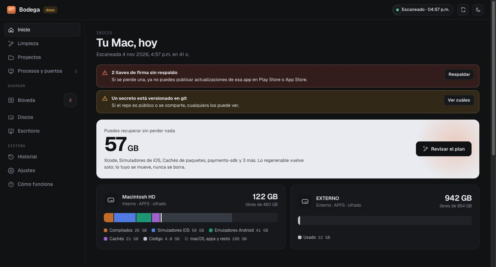
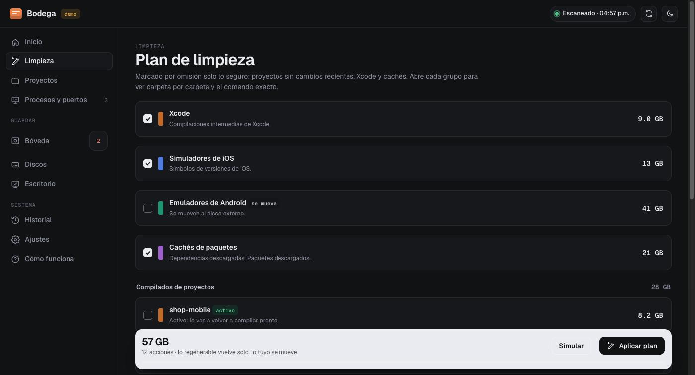

# Bodega

**Administra el espacio de tu Mac de desarrollo.** Bodega te dice qué ocupa el disco, cuánto puedes recuperar sin perder nada, qué proyecto tiene servidores abiertos, qué puede vivir en un disco externo y dónde están las llaves de firma que no te puedes dar el lujo de perder.

Corre en tu Mac, en **http://localhost:2633** (en el teclado de un teléfono se escribe B-O-D-E). Sin nube, sin cuentas, sin telemetría.



## Qué hace

- **Limpieza con plan.** Encuentra los compilados de cada proyecto (`build`, `bin`, `obj`, `.dart_tool`, `node_modules`, `target`, `Pods`, `.venv`…) y las cachés globales (Xcode, simuladores, Gradle, npm, Yarn, pnpm, NuGet, pub, CocoaPods, Homebrew). Arma un plan con el tamaño, el comando exacto y cómo vuelve cada cosa. Puedes simularlo antes de aplicarlo.
- **Proyectos.** Tamaño real contra compilados, tecnologías detectadas, último cambio, cambios sin commit, puertos abiertos y secretos. Limpias uno o lo **mueves a otro disco** con copia verificada, dejando un acceso en su ruta original para que tu IDE y tu terminal sigan igual. Se regresa con un clic.
- **Procesos y puertos.** Cada puerto que escucha con el proyecto que lo abrió (por la carpeta del proceso), su memoria, y los daemons que se quedan vivos (Gradle, Kotlin, .NET, Dart). Los detienes con confirmación.
- **Discos.** Uso por tipo, formato, cifrado y permisos de cada disco. Reubica al disco externo los emuladores de Android, Gradle, NuGet, pub y los Archives de Xcode con la variable oficial de cada herramienta (`ANDROID_AVD_HOME`, `GRADLE_USER_HOME`, `NUGET_PACKAGES`, `PUB_CACHE`).
- **Bóveda.** Inventario de llaves de firma (`.jks`, `.keystore`, `.p12`), `key.properties`, certificados, `google-services.json` y `.env`, y te avisa cuáles están versionados en git. Los respalda en una imagen cifrada AES-256 en tu disco externo con SHA-256 por archivo. Nunca muestra su contenido.
- **Escritorio.** Ordena Escritorio y Descargas por tipo (capturas, notas, PDF, instaladores) sin borrar nada.
- **Claude Code.** Un servidor MCP expone las mismas funciones; lo que modifica algo pide tu confirmación.



## Seguridad

- Lo **regenerable** se borra porque vuelve solo con la siguiente compilación o descarga. Lo **tuyo** (proyectos, archivos, Archives) nunca se borra: se mueve o va a la Papelera.
- Una carpeta sólo cuenta como compilado si su ecosistema lo dice: `bin` y `obj` junto a un `.csproj`, `node_modules` junto a `package.json`, `build` junto a `pubspec.yaml`, `build.gradle` o `Podfile`. Un `build/` de documentación no se toca.
- Nunca opera fuera de tu carpeta de usuario o de un volumen externo, ni sobre `/`, `~` o carpetas del sistema. Nunca borra a través de enlaces simbólicos.
- El servidor escucha sólo en `127.0.0.1`, exige un token por instalación (`~/.bodega/token`), rechaza otros `Host` y `Origin` y sólo ejecuta acciones del último plan por ID, nunca rutas que mande el navegador.
- Detener procesos: sólo los del último listado, de tu usuario y nunca a Bodega; SIGTERM y, a los 5 s, SIGKILL.

## Requisitos

- macOS (probado en macOS 26).
- Node.js 22.18 o más nuevo: Bodega corre TypeScript directo, sin compilar el motor.

## Instalación

```bash
git clone https://github.com/ReyDavidAG/bodega.git
cd bodega
npm ci
npm run build          # compila el dashboard
npm link               # deja el comando `bodega` disponible
bodega install         # lo arranca con tu sesión (LaunchAgent)
bodega open            # http://localhost:2633
```

Si no quieres que corra siempre: `bodega serve` en una terminal y `bodega uninstall` para quitar el LaunchAgent.

## CLI

```text
bodega status            espacio libre y cuánto se puede recuperar
bodega plan [--fresh]    el plan de limpieza con sus IDs
bodega apply [--yes]     aplica lo marcado por omisión, pidiendo confirmación
bodega ports             puertos abiertos y qué proyecto los abrió
bodega stop <puerto>     detiene el proceso de ese puerto
bodega mcp               servidor MCP para Claude Code
```

## Con Claude Code

```bash
claude mcp add bodega -- bodega mcp
```

Luego pídele, por ejemplo, "¿qué me está llenando el disco?", "arma un plan para liberar 30 GB sin tocar los proyectos activos" o "¿qué está escuchando en el 5173?". Las herramientas que modifican algo exigen `confirmed: true`, que Claude manda sólo después de preguntarte.

## Ajustes

En el dashboard eliges qué carpetas son de proyectos (por omisión `~/Developer`), cuántos días cuenta un proyecto como activo (14) y cuál es tu disco externo. Todo se guarda en `~/.bodega/`.

## Desarrollo

```bash
npm run dev     # servidor en 2633 con recarga + Vite en http://localhost:2634
npm test        # pruebas del motor, del servidor y del MCP
npm run lint
BODEGA_DEMO=1 BODEGA_PORT=2635 node src/cli/main.ts serve   # datos ficticios, nada toca tu disco
```

Guía de contribución en [CONTRIBUTING.md](CONTRIBUTING.md).

## English

Bodega is a local dashboard, CLI and MCP server to manage disk space on a macOS development machine: build artifacts and caches per ecosystem (Flutter, .NET, Node, Rust, Gradle, Xcode, Python), iOS simulators and Android emulators, listening ports per project, moving projects and caches to an external drive with verified copies, and an encrypted backup of signing keys and `.env` files. It runs on `127.0.0.1:2633` with a per-install token. UI is in Spanish; contributions to translate it are welcome.

## Licencia

[MIT](LICENSE)
